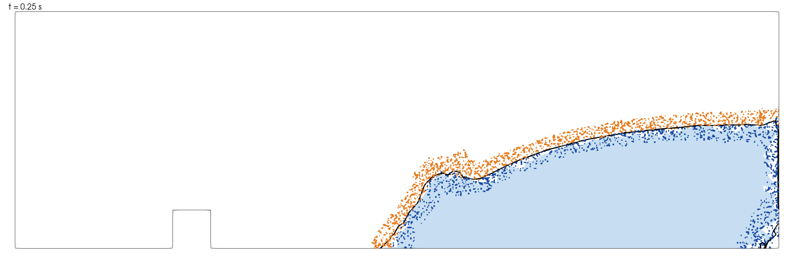
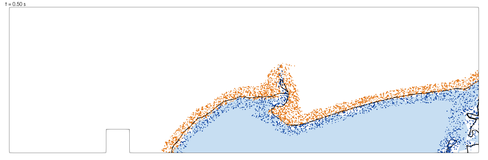
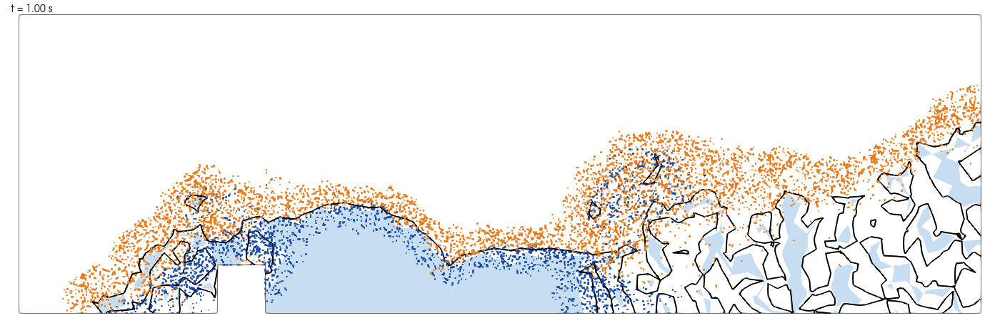
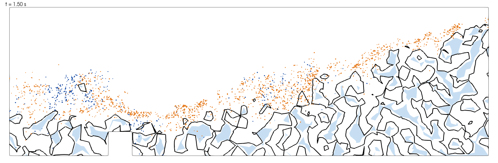
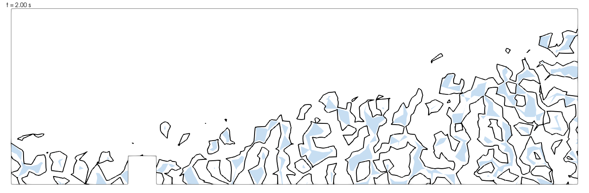
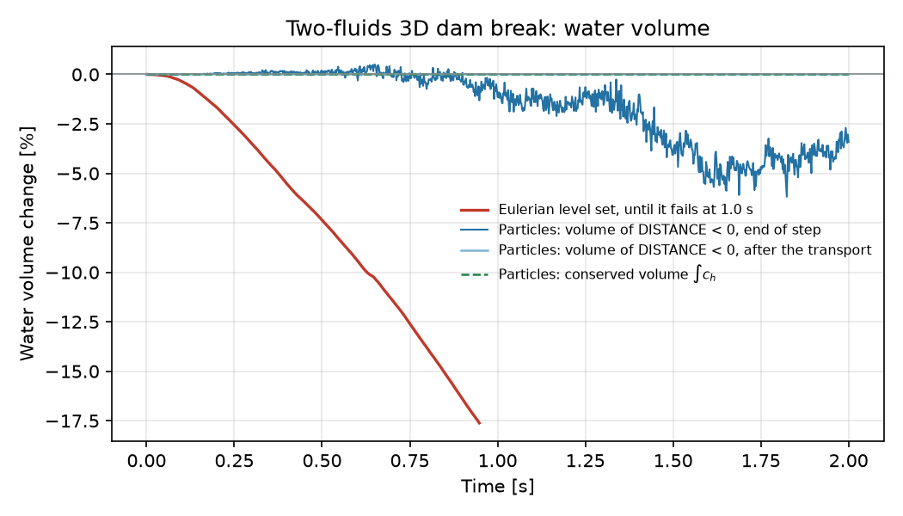

# Two-fluids dam break scenario with particle level set transport

**Author:** [Vicente Mataix Ferrándiz](https://github.com/loumalouomega)

**Kratos version:** 10.4

**Source files:** [Two-fluids dam break scenario with particles](https://github.com/KratosMultiphysics/Examples/tree/master/fluid_dynamics/validation/two_fluid_dam_break_particles/source)

## Case Specification
This is the [two-fluids dam break](https://github.com/KratosMultiphysics/Examples/blob/master/fluid_dynamics/validation/two_fluid_dam_break/README.md) example, with the same mesh (92,461 tetrahedra), materials, boundary conditions and initial state. A water-filled cuboid is released at time 0, spreads across the domain and splashes against an obstacle. The only change is how the water surface is transported: the default Eulerian level set convection is replaced by the **particle level set transport**, based on the PDE-constrained particle-mesh projection of LEoPart (Maljaars et al.).

Lagrangian particles carry a water/air indicator and a signed distance. Every time step the indicator is projected onto the mesh with a projection constrained by a discrete conservation law, so the water volume changes only through the boundary fluxes and is conserved exactly in each element. The nodal `DISTANCE` used by the two-fluid elements is rebuilt from the particles and shifted to match that volume. The method is documented in the [Kratos documentation](https://kratosmultiphysics.github.io/Kratos/pages/Applications/Fluid_Dynamics_Application/Particle_Level_Set_Transport/Overview.html).

Compared with the original example, `ProjectParameters.json` adds the following to the `solver_settings`:

```json
"eulerian_fm_ale": true,
"levelset_transport_type": "particle_pde_projection",
"particle_pde_projection_settings": {
    "echo_level": 1,
    "particles_output": {
        "model_part_name": "FluidParticles",
        "interval": 25,
        "stride": 10
    }
}
```

All the other particle settings use their defaults for 3D: 40 particles per element at the start, kept between 25 and 80. The top of the domain is an outlet: the water that leaves through it is taken into account in the conserved volume, and the fluid that would enter through it is air.

`"eulerian_fm_ale": true` is the default of the hydraulic solver and is written here explicitly. With it the Eulerian level set convection does not move the interface (the mesh velocity equals the fluid velocity at the free nodes), while the particles are not affected. See the [documentation](https://kratosmultiphysics.github.io/Kratos/pages/Applications/Fluid_Dynamics_Application/Particle_Level_Set_Transport/Design_Decisions_and_Results.html).

## Visualizing the particles
`particles_output` copies every tenth particle to the model part `FluidParticles` every 25 steps (0.05 s). Each particle is a point with `DISTANCE`, its signed distance, and `PHASE_FRACTION`, 1 for water and 0 for air. A second VTK output process writes it to `vtk_output_particles/`. The fluid VTK output also writes the projected indicator `PHASE_FRACTION`.

In ParaView, open `vtk_output_particles/FluidParticles_0_*.vtk`, use the *Points* representation, colour by `PHASE_FRACTION`, and apply a *Threshold* on `DISTANCE` to keep the particles next to the interface, as in the pictures below.

## Results
The case was run to 2 s with a time step of 0.002 s (1,000 steps). The pictures show the mid-plane y = 0.5: the water (light blue), the zero level set of `DISTANCE` (black line) and the particles closer than 0.04 m to the interface, in a slab of 0.1 m around the plane, coloured by phase (water in blue, air in orange).

<p align="center">
  
</p>

<p align="center">
  
</p>

<p align="center">
  
</p>

<p align="center">
  
</p>

<p align="center">
  
</p>

### Water volume
The conserved volume $\int c_h$ is 0.674197 m³ over the whole run and does not change beyond round-off (2.9e-15 m³ per step at most). The local conservation residual is below 1.7e-15 in every step. The volume of the region `DISTANCE < 0` right after the transport matches it to 0.013 %.

The volume of `DISTANCE < 0` at the end of the step, after the redistancing and the flow solution, is lower: between 0.5 % above and 6.2 % below $\int c_h$, with 3.4 % below at 2 s. It is shifted back to $\int c_h$ at the start of the next step, so the difference does not accumulate. It grows with the splashes, where thin sheets of water are narrower than the mesh size and the redistancing cannot represent them. It is visible in the pictures as small isolated water regions of the mesh next to the obstacle and at the right end of the domain.

The original Eulerian convection, with a moving interface (`"eulerian_fm_ale": false`, the only setting for which the interface moves), loses water from the start: 7 % at 0.5 s and 17.6 % at 0.95 s. That run fails at 1.0 s, with velocities of 1e16 m/s.

<p align="center">
  
</p>

### Limitations observed in this run
* **Facet system.** The conjugate-gradient solver of the projection did not reach the tolerance 1e-6 in 81 of 1,000 steps (the worst relative residual was 3.2e-5). The warning in the log states that the volume is still conserved, and it is: only the indicator can be less accurate in those steps.
* **Velocities.** The 99th percentile of the water velocity is 3.5 m/s at 0.5 s and 6.5 m/s at 1.2 s. A few nodes next to the corners and walls, where there is a thin film of water, have much larger values (several tens of m/s, and 315 m/s at the maximum of the run), so the maximum velocity of the water is not a useful measure for this case.
* **Outlet.** At the top outlet the computed velocity field points into the domain over some faces that touch the splash, from 1.0 s on. The transport takes air as incoming fluid there, so no water is created (an earlier version, that took the level set indicator, created 0.124 m³). The flow solution still sees that flux.
* **Run time.** The run took 10,668 s (2.96 h) on 8 OpenMP threads of a 16-core workstation, shared with the Eulerian run during the first 1,060 s. The particles go from 3.70 million to 4.28 million.

## References
* J.M. Maljaars, R.J. Labeur, N. Trask, D. Sulsky, (2019) "Conservative, high-order particle-mesh scheme with applications to advection-dominated flows", Computer Methods in Applied Mechanics and Engineering 348, pp. 443-465.
* J.M. Maljaars, C.N. Richardson, N. Sime, (2021) "LEoPart: A particle library for FEniCS", Computers & Mathematics with Applications 81, pp. 289-315.
* F. Larese, R. Rossi, E. Oñate, S.R. Idelsohn, (2008) "Validation of the particle finite element method (PFEM) for simulation of free surface flows", Engineering Computations 25(4), pp. 385-425.
