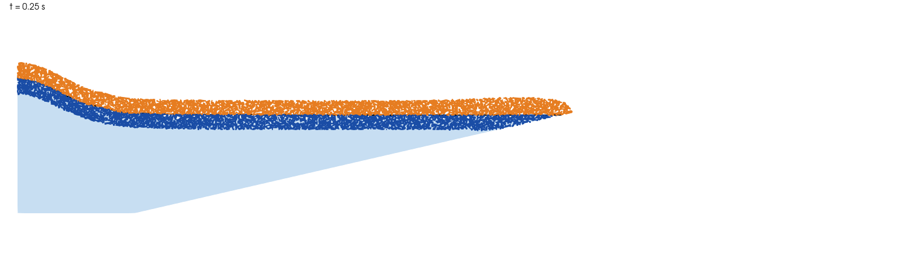
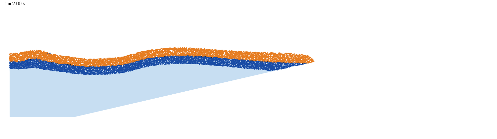
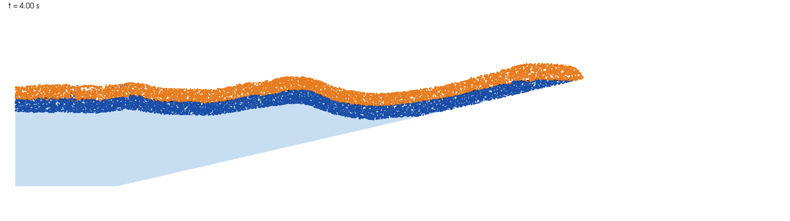
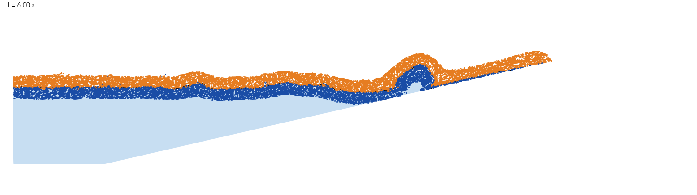
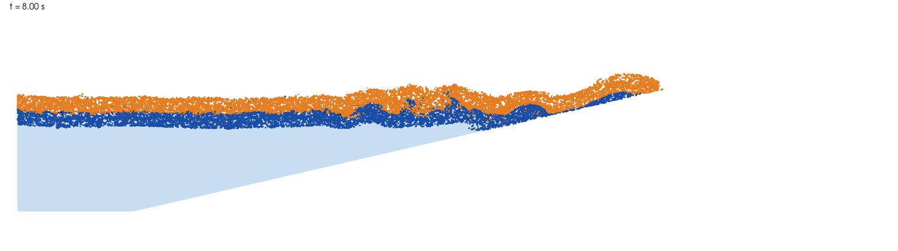
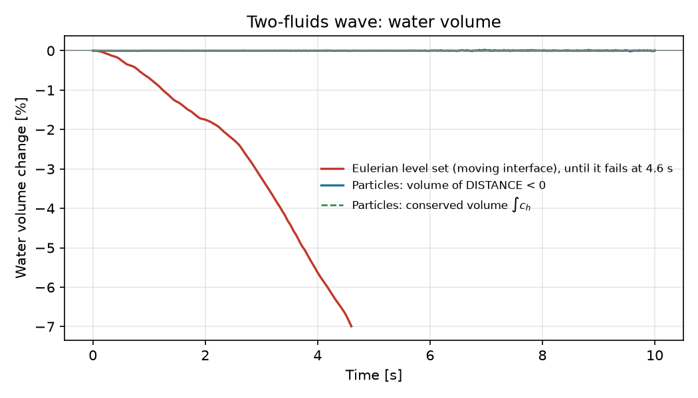

# Two-fluids wave propagation with particle level set transport

**Author:** [Vicente Mataix Ferrándiz](https://github.com/loumalouomega)

**Kratos version:** 10.4

**Source files:** [Two-fluids wave propagation with particles](https://github.com/KratosMultiphysics/Examples/tree/master/fluid_dynamics/validation/two_fluid_wave_particles/source)

## Case Specification
This is the [two-fluids wave propagation](https://github.com/KratosMultiphysics/Examples/blob/master/fluid_dynamics/validation/two_fluid_wave/README.md) example, with the same mesh, materials, boundary conditions and initial state. The only change is how the water surface is transported: the default Eulerian level set convection is replaced by the **particle level set transport**, based on the PDE-constrained particle-mesh projection of LEoPart (Maljaars et al.).

A sine-shaped wave is generated by an artificial elevation of the water surface. It travels across the domain and breaks on a beach where the water depth decreases steadily.

## Particle level set transport
Lagrangian particles carry a water/air indicator and a signed distance, so the interface is advected without numerical diffusion. Every time step the indicator is projected onto the mesh with a projection constrained by a discrete conservation law. The water volume therefore changes only through the fluxes across the domain boundary, up to round-off, and is conserved exactly in each element. The nodal `DISTANCE` used by the two-fluid elements is rebuilt from the particles and shifted to match that volume.

The method, its settings and its validation are documented in the [Kratos documentation](https://kratosmultiphysics.github.io/Kratos/pages/Applications/Fluid_Dynamics_Application/Particle_Level_Set_Transport/Overview.html).

Compared with the original example, `ProjectParameters.json` adds the following to the `solver_settings`:

```json
"eulerian_fm_ale": true,
"levelset_transport_type": "particle_pde_projection",
"particle_pde_projection_settings": {
    "echo_level": 1,
    "particles_output": {
        "model_part_name": "FluidParticles",
        "interval": 25,
        "stride": 2
    }
}
```

All the other particle settings use their defaults: 25 particles per element at the start, kept between 15 and 50, an RK3 particle integration, and the conservative projection penalties. With `echo_level: 1` the log reports, every step:

* the conserved water volume;
* the conservation residuals;
* the range of the projected indicator;
* the volume correction applied to `DISTANCE`.

## Visualizing the particles
`particles_output` copies every second particle to the model part `FluidParticles` every 25 steps. Each particle is a point with two values: `DISTANCE`, its signed distance, and `PHASE_FRACTION`, 1 for water and 0 for air.

A second VTK output process writes this model part to `vtk_output_particles/`, with `"output_control_type": "step"` and the same interval. The fluid VTK output also writes the projected indicator `PHASE_FRACTION`, both nodal and elemental.

To see the particles in ParaView:

1. Open `vtk_output_particles/FluidParticles_0_*.vtk`.
2. Select the *Point Gaussian* or *Points* representation and colour by `PHASE_FRACTION`.
3. A *Threshold* on `DISTANCE` between -0.25 and 0.25 keeps only the particles next to the interface, as in the pictures below.

## Results
The case was run to 10 s, with the given mesh of 5,635 triangles. The population control adds particles to the elements that fall below the minimum.

The pictures show the water (light blue) and the zero level set of `DISTANCE` (black line). The particles closer than 0.25 m to the interface are drawn coloured by their phase: water in blue, air in orange.

<p align="center">
  
</p>

<p align="center">
  
</p>

<p align="center">
  
</p>

<p align="center">
  
</p>

<p align="center">
  
</p>

### Water volume
The conserved volume $\int c_h$ of the particle transport stays constant to 1.9e-13 %. In every step, the local conservation residual is below 6e-16 and the projection system converges to 1e-8. The domain is closed, so there is no flux through the boundary.

The volume of the region where `DISTANCE < 0` is plotted at the end of each step, after the redistancing. It deviates by at most 0.026 % from the initial volume. The deviation comes from the redistancing and is removed at the start of the next step, when the distance is shifted back to the conserved volume.

The Eulerian level set convection loses water instead: 1.75 % at 2 s and 7 % at 4.6 s, where the run fails (see the next section). The curve below stops there.

<p align="center">
  
</p>

### Level set convection and `eulerian_fm_ale`
The hydraulic solver option `eulerian_fm_ale` (default `true`) sets the mesh velocity equal to the fluid velocity at the free nodes. The Eulerian level set convection advects `DISTANCE` with the velocity relative to the mesh, so with the option on the Eulerian interface does not move at all (we measured 0 of 2,985 nodes changing sign in 10 s). The particles are advected with the fluid velocity directly and are not affected. For this reason:

* the particle example keeps the default `"eulerian_fm_ale": true`, which is written explicitly in `ProjectParameters.json`;
* an Eulerian run with a moving interface needs `"eulerian_fm_ale": false`, and that is the only Eulerian reference that makes sense to compare with.

With `"eulerian_fm_ale": false` both transports fail at the same moment, when the wave breaks on the beach: the Eulerian run at 4.67 s (after losing 7 % of the water) and the particle run at 4.48 s. The cause is then in the flow solution with this option, not in the level set transport. With the option on, the particles run to 10 s: the maximum water velocity stays between 1 and 8 m/s, and the automatic time step (CFL 0.5) goes from 0.01 s down to 0.005 s when the wave breaks.

### Run time
| Run | Time steps | Run time |
|---|---|---|
| Particles, `eulerian_fm_ale: true` | 1,169 | 450 s |

The particle run took 450 s on 8 OpenMP threads of a 16-core workstation, which was shared with another run. The particles start at 140,875 and end at 157,213; the projected indicator stays in [-0.042, 1.38], with the largest overshoots where the wave breaks. The conservation is not affected by them.

## References
* J.M. Maljaars, R.J. Labeur, N. Trask, D. Sulsky, (2019) "Conservative, high-order particle-mesh scheme with applications to advection-dominated flows", Computer Methods in Applied Mechanics and Engineering 348, pp. 443-465.
* J.M. Maljaars, C.N. Richardson, N. Sime, (2021) "LEoPart: A particle library for FEniCS", Computers & Mathematics with Applications 81, pp. 289-315.
